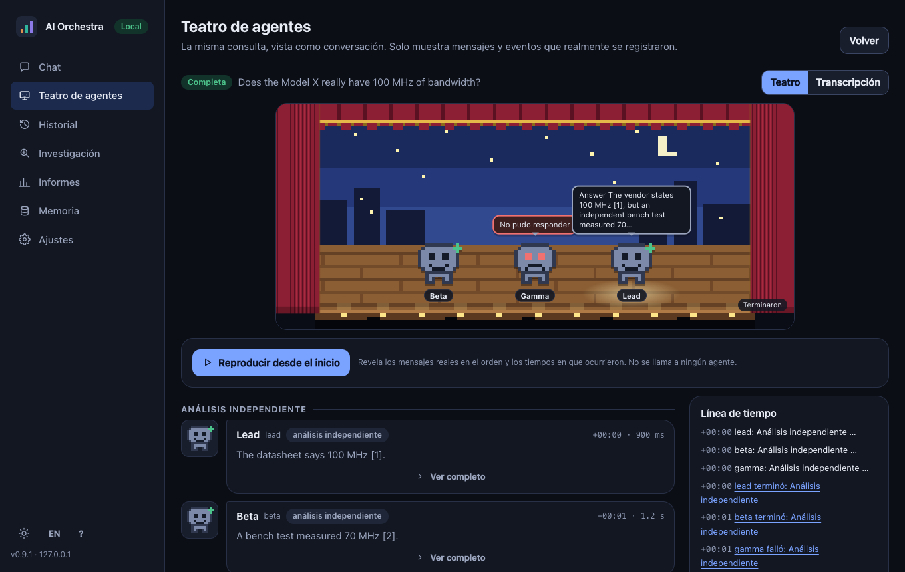
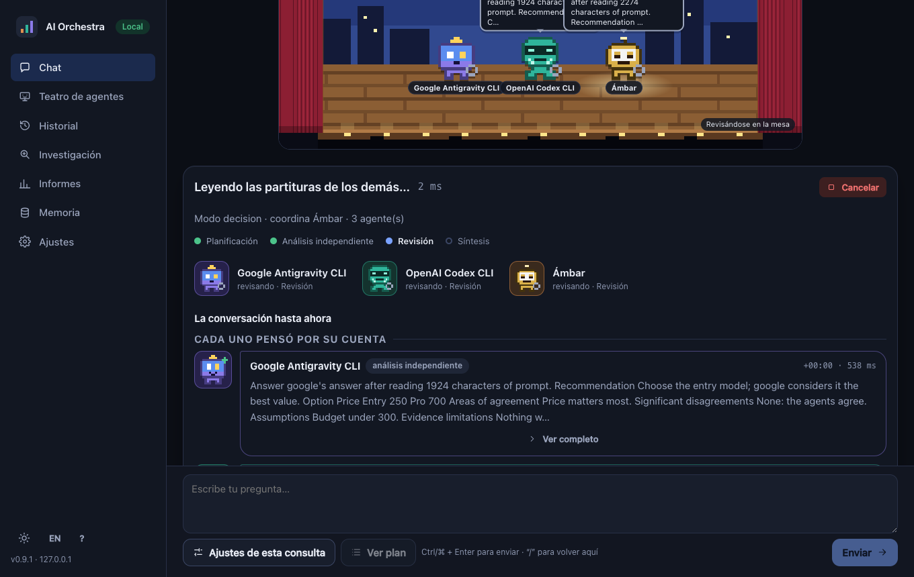
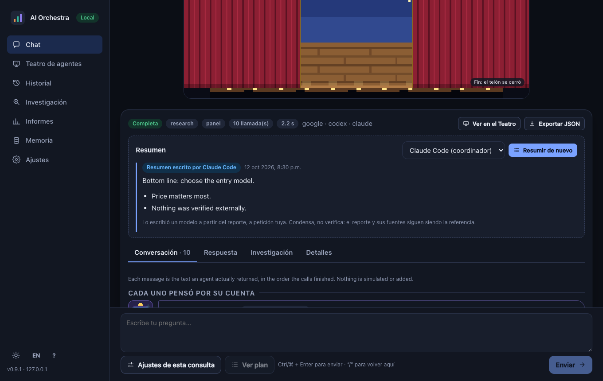
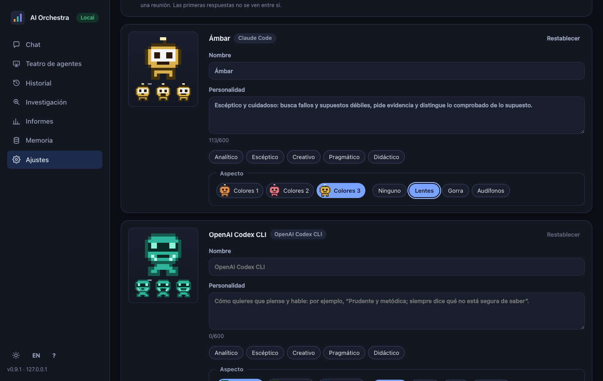
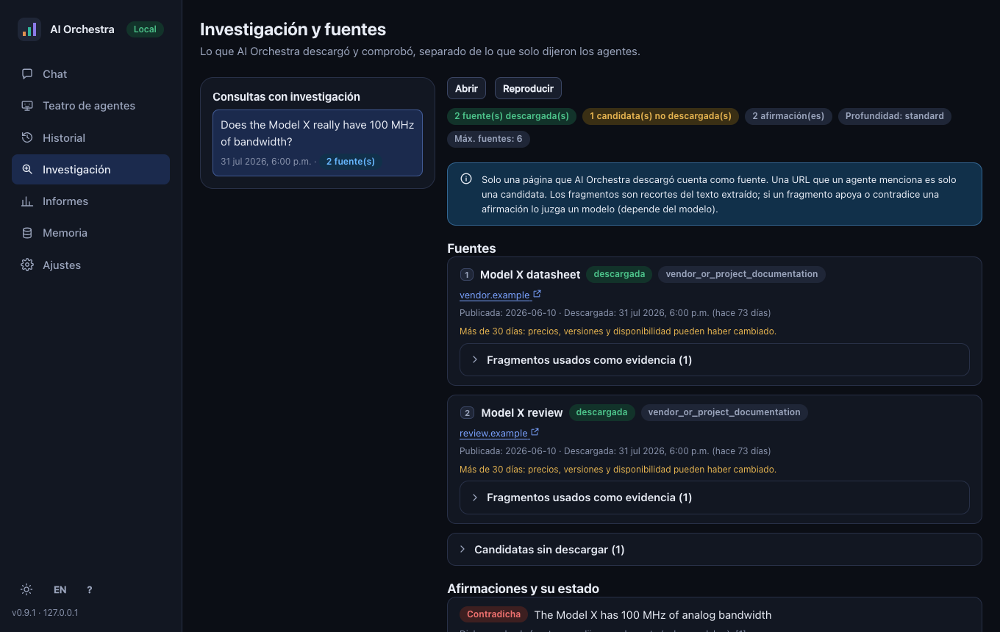
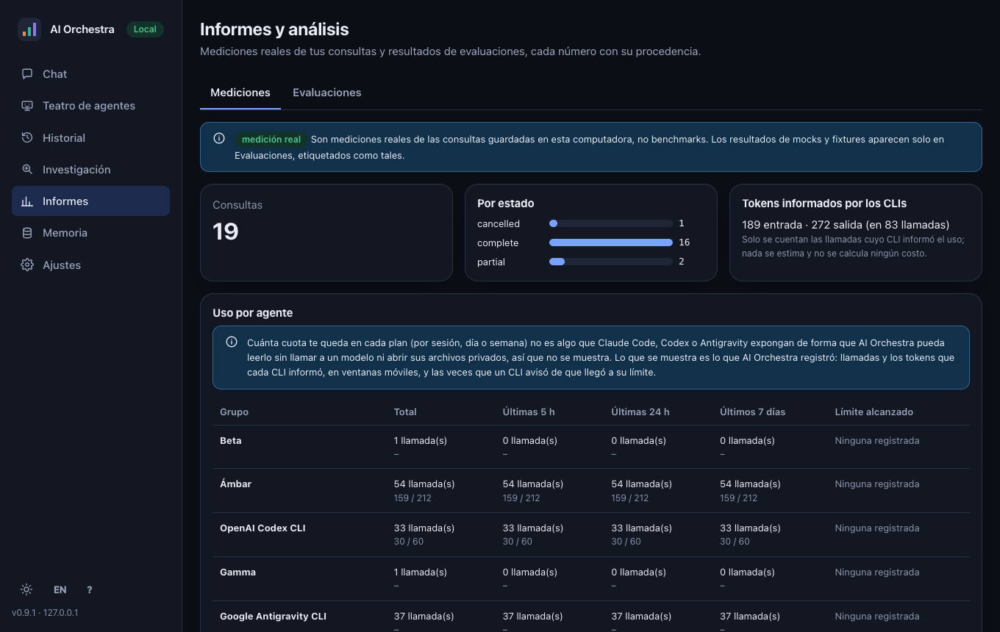

# AI Orchestra

[](https://github.com/encodi/ai-orchestra/actions/workflows/ci.yml)
[](#licencia)

**Hazle la misma pregunta a varios asistentes de IA, deja que se revisen entre sí y recibe una respuesta
ponderada que conserva los desacuerdos.** AI Orchestra es un orquestador multiagente, local primero, escrito en
Rust. No habla con ninguna API de modelos: maneja como subprocesos las **CLI oficiales** que ya tienes
instaladas y con sesión iniciada.

| Agente | CLI que maneja | Id de proveedor |
|---|---|---|
| Anthropic Claude Code | `claude` | `claude` |
| OpenAI Codex CLI | `codex` | `codex` |
| Google Antigravity | `agy` | `google` |

*English: [README.md](README.md)*



> Las capturas se tomaron con los **agentes simulados** del proyecto (las CLI falsas de las pruebas de
> navegador), así que el texto que se ve es de relleno, no salida de un modelo real. La interfaz está en
> español e inglés (botón en la barra lateral).

## Por qué

- **Una pregunta, varias respuestas independientes.** Cada agente responde primero por su cuenta, luego revisa a
  los demás, y un coordinador escribe la respuesta final indicando qué es incierto y dónde hubo desacuerdo.
- **Tus suscripciones, sin claves de API.** Las peticiones pasan por las CLI que ya pagas. No se leen, guardan ni
  reenvían claves, tokens ni archivos de credenciales, y las variables `*_API_KEY` se quitan del entorno del
  proceso hijo.
- **Solo lectura por defecto.** Los agentes no pueden escribir archivos salvo que lo pidas con una opción explícita.
- **Que coincidan no es verificar.** En modo investigación, AI Orchestra descarga las páginas por sí mismo con un
  descargador endurecido, un modelo solo juzga pasajes recortados de esas páginas, y las citas las escribe el
  programa desde sus propios registros.
- **Números honestos.** Los tokens son los que informó cada CLI; lo demás se etiqueta como estimación. Una
  ejecución fallida o parcial nunca se presenta como completa.
- **Solo local.** La interfaz web escucha en loopback y valida `Host`/`Origin`; nada sale de tu equipo salvo lo
  que envían las propias CLI.

## Qué incluye

| | |
|---|---|
| `ai-orchestra consult` | Consulta inteligente: elige estrategia (`fast`, `balanced`, `thorough`), agentes y rondas dentro de límites de llamadas y tiempo, y explica por qué. Todo se puede fijar a mano. |
| `ai-orchestra debate` | Debate acotado: el coordinador propone, los demás revisan, opcionalmente otra ronda, y una síntesis. |
| Investigación | `--web`, `--depth`, `--url`, `--verify`: fuentes y estado de cada afirmación calculados a partir de evidencia descargada. |
| Chat | `ai-orchestra` en una terminal: preguntar, dar seguimiento, cambiar ajustes con `/comandos`, retomar sesiones. |
| Memoria | Memoria local SQLite + FTS5 que agrega un bloque pequeño y etiquetado de contexto. Solo se escribe cuando lo pides. |
| Servidor MCP | `ai-orchestra mcp serve` permite que Claude Code, Codex o Antigravity usen a *los otros* agentes como herramientas. |
| Interfaz web | `ai-orchestra web`: chat, **Teatro de agentes**, historial, explorador de fuentes, informes, memoria y ajustes. |
| Evaluación | `ai-orchestra eval`: mide si varios agentes superan a uno, con comparación a ciegas y estadística que se niega a comparar muestras pequeñas. |

## Instalación

Necesitas una versión estable reciente de [Rust](https://rustup.rs) (edición 2024; desarrollado con 1.99) y al
menos una de las CLI de arriba, con sesión iniciada. **No** hace falta Node.js: la interfaz web compilada está
incluida en el repositorio (`web/dist`) y embebida en el binario.

```sh
git clone https://github.com/encodi/ai-orchestra.git
cd ai-orchestra
cargo build --release
# el binario: target/release/ai-orchestra   (ponlo en tu PATH si quieres)
```

Revisa qué hay disponible (no envía ningún prompt ni gasta cuota):

```sh
./target/release/ai-orchestra doctor
```

### Configuración opcional

Funciona con los valores por defecto. Para fijar modelos o el coordinador, copia el ejemplo y edítalo:

```sh
cp ai-orchestra.example.toml ai-orchestra.toml
```

Orden de búsqueda: `--config <archivo>`, luego `$AI_ORCHESTRA_CONFIG`, luego `./ai-orchestra.toml`, luego
`~/.config/ai-orchestra/config.toml`. Ojo: **`$AI_ORCHESTRA_CONFIG` gana sobre `./ai-orchestra.toml`**; si una
variable olvidada apunta a un archivo viejo, los ajustes de tu proyecto se ignoran sin avisar.

## Uso

### Desde la terminal

```sh
# Una pregunta, todo automático
ai-orchestra consult "¿Qué osciloscopio conviene para aprender electrónica?"

# Ver el plan y el presupuesto de llamadas sin llamar a ningún agente
ai-orchestra consult "Compara Rust y Go para una herramienta CLI" --dry-run

# Elegir tú
ai-orchestra consult "Compara Rust y C++" --mode decision --strategy thorough
ai-orchestra consult "..." --coordinator codex --agents claude,codex,google --rounds 2
ai-orchestra consult "..." --max-agent-calls 4 --max-duration 120

# Investigación con fuentes y verificación de afirmaciones
ai-orchestra consult "¿Qué cambió recientemente en computación cuántica?" --mode research --depth deep

# Un debate acotado, viéndolo en vivo
ai-orchestra debate "¿Cuál es la mejor arquitectura para un servidor MCP en Rust?" --live

# Modo conversación, historial y un solo agente
ai-orchestra
ai-orchestra history search "osciloscopio"
ai-orchestra ask claude "Explica ownership en Rust"
```

La respuesta sale por stdout y los diagnósticos por stderr. Los códigos de salida distinguen éxito, resultado
parcial, problemas de autenticación o cuota, y timeouts. La referencia completa está en
[docs/reference.md](docs/reference.md) (en inglés).

### Desde el navegador

```sh
ai-orchestra web --open     # http://127.0.0.1:8765
```



- **Chat** con progreso en vivo, cancelación y un formulario para cada ajuste de la consulta.
- **Teatro de agentes**: la consulta como conversación entre personajes de píxeles en un escenario. Los globos
  son los mensajes reales grabados, nunca diálogo inventado; las consultas pasadas se pueden reproducir.
- **Resumir**: una llamada explícita al coordinador, etiquetada como escrita por ese agente; no reemplaza el reporte.



- **Personajes**: dale a cada agente un nombre, una personalidad breve y un aspecto. Solo afecta el tono, nunca
  lo que el agente puede hacer.



- **Investigación y fuentes**: lo que AI Orchestra descargó, separado de lo que los agentes solo dijeron.



- **Informes**: mediciones reales de tus consultas, con los tokens que informó cada CLI por agente. La cuota
  restante *no* se muestra porque ninguna CLI la expone sin llamar a un modelo.



Más en la [guía de la interfaz web](docs/web-ui-user-guide.md).

### Como servidor MCP

```sh
ai-orchestra mcp config claude    # imprime instrucciones para un host; no registra nada
```

## Modelo de seguridad, en corto

AI Orchestra nunca usa un shell (arma vectores de argumentos), nunca ejecuta nada que produzca un agente, mantiene
a los agentes en solo lectura salvo que lo permitas, oculta secretos antes de guardar algo, trata páginas web y
memoria recordada como **datos, nunca instrucciones**, y rechaza la recursión. Las reglas completas están en
[AGENTS.md](AGENTS.md).

## Estado del proyecto

Es un proyecto joven. Se prueba con agentes simulados, CLI falsas, bases de datos temporales y un navegador real, y
partes se ejecutaron en vivo contra las CLI reales; el registro de lo verificado y lo no verificado está en
[docs/validation.md](docs/validation.md).

- Desarrollado y probado en **macOS**. Linux lo ejerce la CI; Windows no está probado.
- Las CLI cambian seguido y una actualización puede romper un adaptador: abre un issue con la salida de
  `ai-orchestra doctor`.
- En las pequeñas evaluaciones a ciegas del autor, varios agentes **no** demostraron dar respuestas más correctas
  que uno solo ([docs/evaluation-benchmarks.md](docs/evaluation-benchmarks.md)). La herramienta busca mostrar
  desacuerdos e incertidumbre, y medir en vez de suponer.

## Contribuir

Las contribuciones son bienvenidas: lee [CONTRIBUTING.md](CONTRIBUTING.md) (flujo de ramas, verificaciones y reglas
duras). Sigue el [Código de conducta](CODE_OF_CONDUCT.md). Para temas de seguridad, ve [SECURITY.md](SECURITY.md).

## Licencia

Con licencia, a tu elección, bajo

- Apache License, Version 2.0 ([LICENSE-APACHE](LICENSE-APACHE))
- Licencia MIT ([LICENSE-MIT](LICENSE-MIT))

Salvo que indiques lo contrario, toda contribución enviada para su inclusión se licencia de la misma forma doble,
sin términos adicionales.

Copyright © 2026 Enrique C.

*Claude Code, Codex y Antigravity son productos de sus respectivos dueños. Este proyecto es independiente y no está
afiliado ni respaldado por Anthropic, OpenAI ni Google.*
